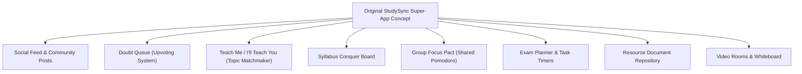
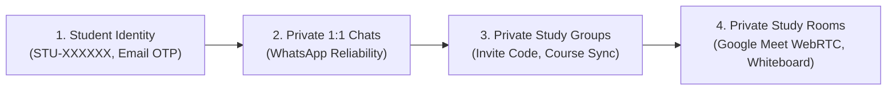
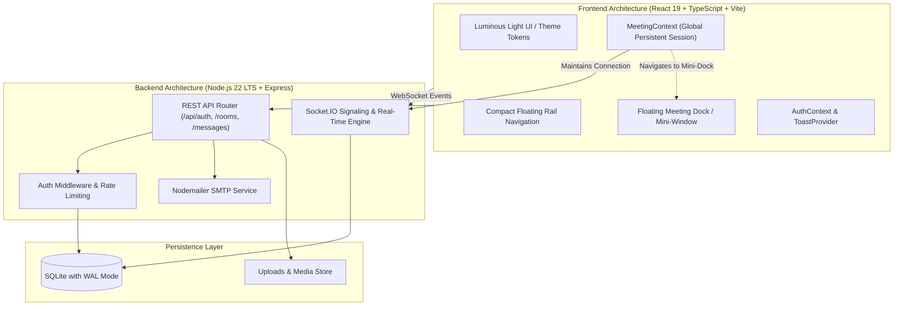
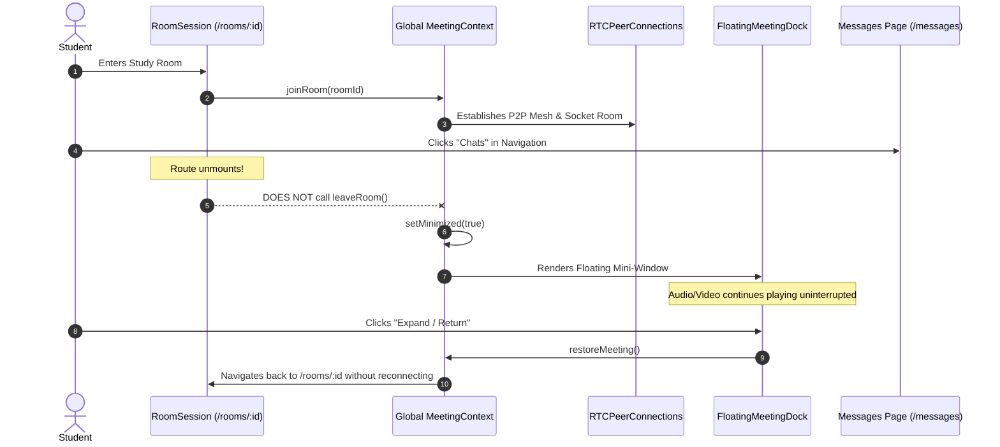
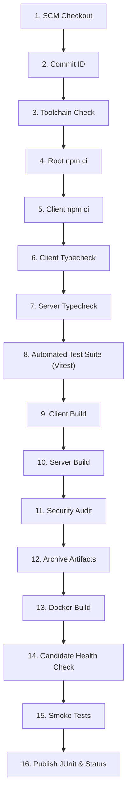

# StudySync

> **Private Student Collaboration & Real-Time Academic Communication Platform**  
> *"Learn together. Teach each other. Achieve more."*

---

## Table of Contents

- [Section A — Project Introduction](#section-a--project-introduction)
- [Section B — Previous Architecture and Original Concept](#section-b--previous-architecture-and-original-concept)
- [Section C — Current StudySync Product Vision](#section-c--current-studysync-product-vision)
- [Section D — Current Application Architecture](#section-d--current-application-architecture)
- [Section E — Features & Student User Journeys](#section-e--features--student-user-journeys)
- [Section F — Project Structure](#section-f--project-structure)
- [Section G — Local Setup & Execution](#section-g--local-setup--execution)
- [Section H — Environment Variables](#section-h--environment-variables)
- [Section I — Docker & Containerization](#section-i--docker--containerization)
- [Section J — Jenkins CI/CD Pipeline](#section-j--jenkins-cicd-pipeline)
- [Section K — Security & Authorization Architecture](#section-k--security--authorization-architecture)
- [Section L — Automated Testing Suite](#section-l--automated-testing-suite)
- [Section M — Future Roadmap](#section-m--future-roadmap)

---

## Section A — Project Introduction

### What is StudySync?
StudySync is a secure, private communication and real-time collaboration platform engineered specifically for students in engineering, medical, and higher education programs. It bridges the gap between chaotic general-purpose messaging apps and heavyweight enterprise conferencing tools by providing a focused, noise-free academic workspace.

### Why Was It Created?
University and college students frequently struggle with fractured collaboration workflows:
1. **Public Chat Apps (WhatsApp / Discord / Telegram):** Lack dedicated academic identity, suffer from distraction, mix personal chats with study groups, and offer limited integrated study tools.
2. **Corporate Meeting Software (Zoom / Google Meet / Teams):** Disconnect immediately upon navigating away, offer sterile environments without contextual group study spaces, and lack persistent peer workspaces.

StudySync unites **WhatsApp-style reliable private messaging** and **Google Meet-style persistent real-time video/audio collaboration** in an elegant, lightweight application.

### Intended Student Audience
- Undergraduate and graduate engineering, medical, computer science, and STEM cohorts.
- Peer study circles, project teams, laboratory partners, and academic clubs.
- Competitive examination study groups requiring distraction-free audio/video rooms, live whiteboards, and private messaging.

---

## Section B — Previous Architecture and Original Concept

The original conception of StudySync was an all-encompassing campus social-learning super-app. In its earlier iterations, the codebase explored a broad spectrum of academic features:



### Legacy Features Status

| Feature Name | Original Role | Current Product Status |
| :--- | :--- | :--- |
| **Doubt Queue** | In-meeting question prioritization with upvoting | *Retired from primary navigation; database schema retained.* |
| **Teach Me / I'll Teach You** | Skill exchange topic marketplace | *Retired from primary navigation; direct peer messaging replaces it.* |
| **Syllabus Conquer Board** | Unit/chapter progress tracker | *Retired; replaced with focused group messaging.* |
| **Group Focus Pact** | Synchronized synchronized Pomodoro session | *Retired to eliminate timer drift complexity.* |
| **Public Community Feed** | Campus-wide microblogging & voting | *Retired to prioritize privacy and prevent academic distraction.* |
| **Exam Planner & Resources** | Calendar countdowns & file sharing | *Consolidated into direct and group file attachments.* |

### Why Was the Product Simplified?
Feature bloat overwhelmed students with multiple competing dashboards. Research showed students primarily need:
1. Instant student verification and lookup by **Student ID**.
2. **Direct, WhatsApp-like messaging** with read receipts and persistent history.
3. **Private study groups** that don't leak information to strangers.
4. **Reliable video study rooms** that don't abruptly hang up when checking messages or notes.

---

## Section C — Current StudySync Product Vision

The modern StudySync architecture is refined into a focused four-pillar workflow:

$$\text{Student Identity} \longrightarrow \text{Private Chats} \longrightarrow \text{Private Groups} \longrightarrow \text{Private Study Rooms}$$



### The Three Core Experiences
1. **Student Identity & Discovery:** Mandatory email verification, unique alphanumeric Student IDs (`STU-XXXXXX`), secure password recovery via cryptographically hashed 6-digit email OTPs.
2. **Private Messaging & Private Study Groups:** High-performance direct and group chats backed by SQLite and Socket.IO, with delivery tracking, unread counters, and strict server authorization.
3. **Private Collaborative Study Rooms:** WebRTC audio/video meetings with camera/microphone hardware lifecycle management, screen sharing, live whiteboard synchronization, and persistent application-level sessions with floating mini-dock support.

---

## Section D — Current Application Architecture

StudySync uses a decoupled modern stack with an Express and Socket.IO real-time backend, SQLite with WAL mode, and a React + TypeScript frontend.



### Meeting Persistence & Route Navigation Workflow



---

## Section E — Features & Student User Journeys

### 1. Student Identity & Discovery
- **Registration & Mandatory Verification:** Students register with college details and terms acceptance. A 6-digit OTP is dispatched via SMTP; accounts are restricted until verified.
- **Unique Student ID:** Every student receives a permanent, uppercase alphanumeric identifier (e.g. `STU-9K4W2R`). Students can find and connect with peers without exposing personal phone numbers or email addresses.
- **Email OTP Password Reset:** If credentials are lost, students request a 6-digit cryptographic OTP valid for 10 minutes. After OTP verification, an ephemeral reset authorization token enables password update.

### 2. WhatsApp-Style Private Messaging
- **1-to-1 Direct Messaging:** Instant real-time message exchange with persistent SQLite storage and unread counters.
- **Private Study Groups:** Private cohorts created by course, subject, or project. Only active group members can post or view messages.
- **Offline Catch-Up:** Messages are never lost on socket disconnection; conversation history is immediately loaded upon reconnection.

### 3. Google Meet-Style Collaborative Study Rooms
- **Hardware-Accurate Device Lifecycle:** Turning the camera off stops the physical camera track (`MediaStreamTrack.stop()`), ensuring laptop hardware indicator lights turn off immediately.
- **Zero Auto-Capture on Reload:** Reloading a study room enters with camera and microphone muted by default, requiring explicit user activation.
- **Screen Sharing with Live Indicators:** Any participant can present their screen. All participants see a pulsing visual indicator showing who is presenting.
- **Live Whiteboard Synchronization:** Real-time synchronized drawing canvas with vector strokes, shape tools, text annotations, and canvas persistence.
- **Background Meeting Persistence:** Navigating to Dashboard, Chats, or Settings automatically transitions the meeting into a floating mini-dock with live audio/video and mute controls.

---

## Section F — Project Structure

```
StudySync/
├── client/                     # Frontend Application (React 19, TypeScript, Vite)
│   ├── src/
│   │   ├── api/                # REST client & Socket.IO singleton
│   │   ├── components/         # Reusable UI, Layout, Whiteboard, VideoMeeting
│   │   │   ├── ui/             # Design system controls, Buttons, Modals, Badges
│   │   │   ├── Layout.tsx      # Floating navigation rail & top bar
│   │   │   ├── VideoMeeting.tsx# WebRTC media tiles & controls
│   │   │   ├── Whiteboard.tsx  # Multi-tool synchronized canvas
│   │   │   └── FloatingMeetingDock.tsx # Floating mini-window for background calls
│   │   ├── context/            # AuthContext & persistent MeetingContext
│   │   ├── pages/              # Dashboard, Messages, Rooms, RoomSession, Profile
│   │   │   └── auth/           # Login, Register, ForgotPassword (OTP), VerifyEmail
│   │   ├── theme.ts            # Design tokens & color palette
│   │   ├── index.css           # Global typography & animation engine
│   │   ├── App.tsx             # Route definitions & application root
│   │   └── main.tsx            # React DOM entry point
│   ├── package.json
│   ├── tsconfig.json
│   └── vite.config.ts
├── server/                     # Backend Application (Node.js 22, Express, Socket.IO)
│   ├── src/
│   │   ├── config/             # Environment configuration & defaults
│   │   ├── db/                 # Native SQLite initialization & schema migrations
│   │   ├── middleware/         # JWT authentication & session validation
│   │   ├── routes/             # REST API endpoints (auth, rooms, messages, users)
│   │   ├── services/           # Nodemailer SMTP mail templates & sender
│   │   ├── socket/             # Socket.IO signaling, room state & broadcast handlers
│   │   └── index.ts            # Server entry point & Express middleware
│   └── tests/                  # Vitest & Supertest automated test suite
├── docs/                       # Architecture Decision Records (ADRs)
│   └── architecture-decisions.md
├── scripts/                    # Deployment & rollback automation scripts
│   ├── deploy.sh               # Zero-downtime candidate validation deployment
│   └── rollback.sh             # Automated rollback script
├── Dockerfile                  # Multi-stage production container build
├── docker-compose.yml          # Local container orchestration with volume mounts
├── Jenkinsfile                 # Declarative 16-stage CI/CD pipeline
├── package.json                # Root package & monorepo orchestration
├── tsconfig.server.json        # Backend TypeScript configuration
├── vitest.config.ts            # Automated test runner configuration with JUnit XML
└── README.md                   # Complete technical product documentation
```

---

## Section G — Local Setup & Execution

### Prerequisites
- **Node.js:** `v22.x` or higher (uses native `node:sqlite`)
- **npm:** `v10.x` or higher
- **Git**

### Installation Steps

1. **Clone the repository:**
   ```bash
   git clone https://github.com/your-org/studysync.git
   cd studysync
   ```

2. **Install root and client dependencies:**
   ```bash
   npm ci
   cd client && npm ci && cd ..
   ```

3. **Configure environment variables:**
   ```bash
   cp .env.example .env
   ```
   *(Edit `.env` with your desired configuration; development defaults work out of the box).*

4. **Initialize database & start development servers:**
   ```bash
   # Run backend development server (auto-reloading on port 5000):
   npm run dev

   # In a separate terminal, run frontend development server (Vite on port 5173):
   cd client && npm run dev
   ```

5. **Production Build & Execution:**
   ```bash
   npm run build
   npm start
   ```

---

## Section H — Environment Variables

All application configuration is driven by standard environment variables (names only):

| Variable Name | Description | Default / Example |
| :--- | :--- | :--- |
| `PORT` | HTTP server listening port | `5000` |
| `NODE_ENV` | Runtime environment mode | `development` / `production` |
| `APP_BASE_URL` | Fully-qualified public URL | `http://localhost:5000` |
| `JWT_SECRET` | Secret key for signing session & reset tokens | *32+ character random string* |
| `DATABASE_PATH` | Path to SQLite database file | `./studysync.db` |
| `SMTP_HOST` | Outgoing SMTP mail server | `smtp.gmail.com` |
| `SMTP_PORT` | SMTP port (STARTTLS: 587, SSL: 465) | `587` |
| `SMTP_USER` | SMTP username / address | `student-mailer@example.com` |
| `SMTP_PASS` | SMTP password / app password | *Secret* |
| `SMTP_FROM` | Outgoing email display address | `StudySync <noreply@studysync.edu>` |

---

## Section I — Docker & Containerization

### Building the Production Container
```bash
docker build -t studysync:latest .
```

### Running with Docker Compose
```bash
docker compose up -d
```

### Persistent Volumes
- `studysync-data`: Holds `studysync.db`, `studysync.db-wal`, and SQLite journal files.
- `studysync-uploads`: Holds user avatars and room attachments.

### Validating Container Health
```bash
docker ps --filter "name=studysync"
curl -f http://localhost:3000/api/health
```

---

## Section J — Jenkins CI/CD Pipeline

The repository includes a comprehensive, declarative `Jenkinsfile` executing 16 discrete stages:



### Key Deployment Safeguards
1. **Candidate Verification:** Candidate containers are started on staging port `3099` and probed via `/api/health` before replacing live containers.
2. **Preservation of Live Services:** The running production container is never terminated until the candidate image has proven healthy.
3. **Automated Rollback:** If post-deployment smoke tests fail, `scripts/rollback.sh` restores the previous image automatically.
4. **JUnit Reporting:** Publishes `test-results/junit.xml` to Jenkins for test trend analysis.

---

## Section K — Security & Authorization Architecture

- **Server-Authoritative Identity:** Client-provided `sender_id` or `user_id` payload fields are discarded. Every database action derives the authenticated user ID strictly from verified JWT claims.
- **Rate Limiting:** Protects `/api/auth/login`, `/api/auth/register`, and `/api/auth/forgot-password` against brute-force attacks via `express-rate-limit`.
- **OTP Tamper Resistance:** OTP codes are 6-digit cryptographically random integers stored exclusively as SHA-256 hashes, with 10-minute expirations and 5-attempt lockouts.
- **Private Room Access Control:** Users cannot join study rooms without being the host, an active member of the room's group, or providing a valid `ROOM-XXXXXX` invite code.
- **Private Group Boundary:** Sockets and REST endpoints enforce that non-members cannot read or post messages to private study groups.

---

## Section L — Automated Testing Suite

The project includes an end-to-end integration and unit test suite powered by Vitest and Supertest:

```bash
# Run test suite:
npm test

# Run tests with JUnit XML generation for CI:
npm run test:ci

# Run type check across client and server:
npm run typecheck
```

### Coverage Scope
- **Authentication & Email OTP:** Registration, verification gate, Student ID login, OTP generation, failed attempts lockout, expired token rejection, password reset authorization token, password update.
- **Messaging:** Direct message persistence, message reading status, unread count increment, private group membership boundaries.
- **Study Rooms & WebRTC:** Room creation, invite code generation (`ROOM-XXXXXX`), student invitation, room join authorization, participant leave tracking (`left_at`), whiteboard canvas persistence.

---

## Section M — Future Roadmap

Features identified for future release stages:

- [ ] **Selective Forwarding Unit (SFU):** Integration of LiveKit or mediasoup for rooms with 10+ simultaneous video publishers.
- [ ] **Managed TURN Clusters:** Deployment of Coturn infrastructure for campus firewalls requiring symmetric NAT relay.
- [ ] **End-to-End Encrypted Message Blobs:** Signal Protocol double-ratchet encryption for direct peer-to-peer messaging.
- [ ] **Document Picture-in-Picture:** Native multi-window Picture-in-Picture on supported desktop browsers.
- [ ] **Mobile Native Apps:** React Native / Expo wrapper leveraging the existing backend API and Socket.IO engine.
